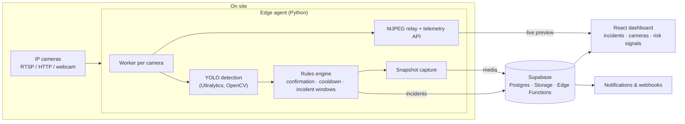

# SentraPPE

Real-time PPE and site-safety monitoring on the CCTV cameras a site already has. An edge agent watches each RTSP stream, detects missing protective equipment and unsafe situations, and pushes incidents to a web dashboard for the HSE team.

Presented at the **BDO Digital Trophy** and demoed to industrial clients. The product code is private; this repository documents the architecture and what it does.

## What it detects

| Category | Rules |
|---|---|
| **PPE** | Helmet, vest, gloves, safety glasses, boots, ear protection, mask (when the model supports it) |
| **Zones** | Intrusion into restricted areas, loitering beyond a time limit |
| **Vehicles** | Person too close to a vehicle or forklift |
| **Occupancy** | Headcount over a per-zone or site-wide limit |
| **Man-down** | Tracked person horizontal and immobile |
| **Fire / smoke** | With a fire- and smoke-capable model |

Alerts go through **temporal confirmation** (N of M frames), **per-rule cooldowns** and **incident windows**, so the HSE team gets one incident instead of a flood of frames.

## Architecture

- **Edge agent:** one worker thread per camera; camera list provisioned from Supabase with a YAML fallback; local HTTP endpoints for telemetry, live MJPEG preview and camera test/restart/enable.
- **Backend:** Supabase Postgres, Storage with signed incident media and automatic purge, and Edge Functions for incident notifications, webhooks, sensor ingestion and risk signals.
- **Dashboard:** React + TypeScript (Vite, Tailwind, shadcn/ui) showing live cameras, incidents with snapshots, and site risk.
- **Deployment:** Docker and Docker Compose (CPU and GPU), a macOS launch agent and a Windows installer for on-site PCs.

## Stack

Python · Ultralytics YOLO · OpenCV · NumPy · Supabase (Postgres, Storage, Edge Functions) · React · TypeScript · Vite · Tailwind · Docker

## Engineering

- 240+ automated tests on the edge agent (pytest) plus Vitest on the dashboard
- Evaluation and training scripts for the PPE models
- Demo runbook and pilot-sprint plan for on-site trials

---

Built by [Amine Benzaazaa](https://github.com/AmineBenzaazaa). I'm happy to walk through the architecture on a call.
